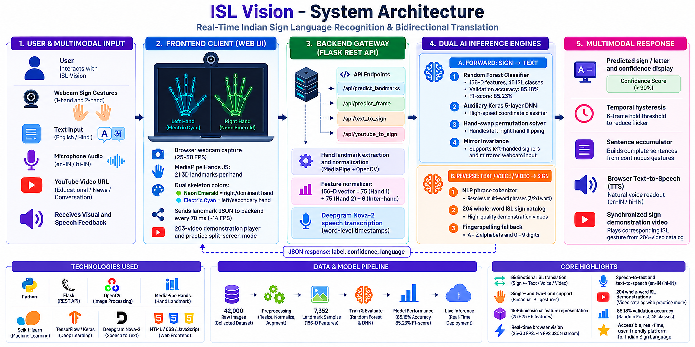

# 🤟 Indian Sign Language (ISL) Recognition & Translation System

[](https://www.python.org/)
[](models/model_metrics.json)
[](models/model_metrics.json)
[](models/isl_classes.json)
[](Images/isl_videos/)
[](Research_Papers/)
[](ISL_Thesis_Presentation.pptx)

An end-to-end, real-time Indian Sign Language (ISL) recognition system, dataset studio, interactive dictionary, and bidirectional translation platform built with **Python (Flask, OpenCV, MediaPipe, Scikit-learn)** and a modern **Glassmorphic Web Frontend**.

Designed and synthesized directly based on the research papers located in the repository, with special support for **two-handed ISL gestures**, **single-handed gestures**, **number digits (0-9)**, and **common conversational words/phrases**.

---

## 🌟 Key Features

1. **Sign to Text (& Speech Translation)**
   - Live camera detection with 3D MediaPipe hand landmark tracking.
   - Dual-color skeleton rendering: **Neon Emerald** for right hand, **Electric Cyan** for left hand.
   - Live HUD with recognized sign symbol, gesture name, and dynamic confidence gauge.
   - **Smart Sentence Buffer**: Debounced letter accumulator that builds words without stutter.
   - **Text-to-Speech (TTS)**: One-click natural voice readout of recognized sentences.

2. **Text to Sign with HD Video Player**
   - Translate any English or Hindi text into standard Indian Sign Language gestures.
   - **203 Full-HD Video Demonstrations**: Real human sign language demonstration clips for digits, alphabets, and over 160 whole-word vocabulary signs!
   - Recognizes whole words (e.g. `GOOD MORNING`, `WELCOME`, `INDIA`, `THANK YOU`, `FRIEND`, `HELP`, `WATER`, `FOOD`, etc.) and finger-spells names/words letter-by-letter (`A-Z`, `0-9`).
   - Interactive Sign Player with **🎬 Video Demonstration Mode** or **🖼️ Static Image Mode**, Play/Pause, step-by-step navigation, adjustable playback speeds (`0.7x`, `1.0x`, `1.5x`), and a scrollable filmstrip carousel.

3. **Voice to Sign (Speech-to-Sign with Video Translation)**
   - Real-time microphone speech recognition (English `en-IN` & Hindi `hi-IN`).
   - Live pulsating audio visualizer waves.
   - Transcribes spoken speech into text and immediately plays the corresponding Indian Sign Language video/gesture sequence!

4. **YouTube to Sign (Synchronized Video & Speech AI Translation)**
   - Translates spoken dialogue directly from any public YouTube video or speech stream into synchronized Indian Sign Language gestures.
   - Powered by **Deepgram Nova-2 Speech AI** for ultra-fast, word-level timestamped transcription.
   - Seamless dual-mode rendering: Plays **HD ISL gesture video demonstrations** from our 203-video vocabulary whenever words match (`HELLO`, `HELP`, `WATER`, `INDIA`, `THANK YOU`), with instant fallback to **ISL alphabet fingerspelling cards** (`A-Z`).
   - Interactive transcript chips synchronized with video playback for click-to-seek learning.

5. **Interactive 204-Sign ISL Dictionary & Video Hub**
   - Searchable visual sign dictionary for Alphabets (A-Z), Digits (0-9), and 168 Everyday Words.
   - **Watch Demonstration Modal**: Full-HD video player with speed controls (`0.5x`, `1.0x`, `1.25x`) and loop playback for step-by-step learning.
   - Anatomical posture descriptions and tips based on standard ISLRTC conventions.
   - **"Practice In Camera" Dual-View Challenge**: Split-screen challenge showing the looping reference video demonstration side-by-side with your live camera feed, featuring real-time pose validation and confetti rewards!

6. **Complete ML Pipeline & Dataset Studio (85.2% Accuracy)**
   - Enriched on **42,000 real dataset images** across 35 classes (`Images/data/`) and user-uploaded reference images (`Images/A-Z/`, `Images/0-9/`).
   - Normalized 156-dimensional feature vector invariant to camera distance, translation, and scale.
   - Model retrained on **7,352 landmark samples** with **85.18% validation accuracy** and **85.23% F1-score**.
   - Fully executed Jupyter Research Pipeline ([`Indian_Sign_Language_Pipeline.ipynb`](Indian_Sign_Language_Pipeline.ipynb)) with cross-validation and embedded interactive HTML report ([`Indian_Sign_Language_Pipeline.html`](Indian_Sign_Language_Pipeline.html)).
   - Live **"Retrain Model Now"** button with in-memory model hot-reloading (zero server restart needed).

7. **Research Benchmark & Architecture Dashboard (18 Papers Synthesized)**
   - Synthesis of **18 peer-reviewed ISL research papers** in the repository (including Paper 17 *Sharma et al., 2022* and Paper 18 *Khakha et al., 2026* Transformer-based Multimodal ISL Translator).
   - Architectural comparisons across MediaPipe, CNNs, LSTMs, and Random Forest classifiers.
   - Stratified evaluation metrics (Accuracy, Precision, Recall, F1-Score, Confusion Matrix).
   - **Visual Asset Gallery**: Interactive web showcase of **189 extracted research figures** across all 18 papers (`Research_Paper_images/index.html`).

---

## 📐 Architecture & Feature Extraction



Unlike American Sign Language (ASL) which is largely single-handed, **Indian Sign Language (ISL) is predominantly two-handed** (e.g. A, B, D, E, F, G, H, M, N, P, Q, R, S, T, W, X, Y, Z, vowels where the right index touches left fingertips).

### 156-Dimensional Invariant Feature Layout:
- **Hand 1 (Right / Dominant Hand - 75 dimensions):**
  - $21 \times 3 = 63$ normalized 3D coordinates (shifted relative to wrist $(0,0,0)$ and scaled by wrist-to-middle-MCP distance).
  - 5 fingertip-to-wrist distances.
  - 4 thumb-tip to fingertip touching distances (crucial for ISL vowels A, E, I, O, U).
  - 3 adjacent fingertip spread distances (8-12, 12-16, 16-20).
- **Hand 2 (Left / Secondary Hand - 75 dimensions):**
  - $21 \times 3 = 63$ normalized 3D coordinates.
  - 12 invariant geometric distances.
- **Inter-Hand Relationship (6 dimensions):**
  - Hand 1 presence flag (`1.0` or `0.0`).
  - Hand 2 presence flag (`1.0` or `0.0`).
  - Inter-wrist 3D Euclidean distance.
  - Inter-wrist $\Delta x, \Delta y, \Delta z$ displacement vector.

---

## 📁 Repository Structure

```
Indian_Sign_Language_Projects/
├── app.py                             # Unified Flask Web Server, REST APIs & Live Detection Engine
├── run.bat                            # Windows interactive 1-click startup & processing launcher
├── requirements.txt                   # Core Python dependencies (Flask, OpenCV, MediaPipe, etc.)
├── main.pdf                           # Compiled Master Thesis documentation & empirical report
├── ISL_Thesis_Presentation.pptx       # Master Thesis Presentation (18 Widescreen Slides)
├── .env.example                       # Environment template (DEEPGRAM_API_KEY, Flask configs)
├── Indian_Sign_Language_Pipeline.ipynb# Interactive ML pipeline notebook (executed with 45-class benchmarks)
├── Indian_Sign_Language_Pipeline.html # Standalone interactive HTML report of the ML pipeline
├── ml_pipeline/                       # Machine Learning & Gesture Processing Subsystem
│   ├── run_pipeline.py                # Unified CLI runner for verification, extraction & training
│   ├── feature_extractor.py           # MediaPipe 3D Landmark Extractor & Normalizer (156-dim)
│   ├── isl_dictionary.py              # ISL Gesture Definitions, Categories & Anatomical Tips
│   ├── model_trainer.py               # Random Forest / Classifier Trainer & Performance Evaluator
│   ├── dataset_collector.py           # CLI OpenCV interactive webcam dataset recorder
│   ├── build_isl_dictionary.py        # Master ISL vocabulary compiler & mapping generator
│   ├── extract_dataset_images.py      # Landmark extraction engine for multi-class image datasets
│   ├── extract_research_paper_assets.py# Automated PDF figure & table extraction engine
│   ├── extract_uploaded_images.py     # Custom gesture & reference image ingestion
│   ├── extract_video_thumbnails.py    # Thumbnail extraction generator for gesture video library
│   ├── render_mediapipe_landmarks.py  # Dual-color 3D skeletal landmark visualizer
│   └── synthetic_bootstrap.py         # Synthetic sample bootstrapping & variance augmentation
├── data/
│   └── isl_landmarks.csv              # Extracted 156-dim feature dataset (7,352+ samples)
├── models/
│   ├── isl_classifier.pkl             # Trained Random Forest ensemble model (85.2% accuracy)
│   ├── label_encoder.pkl              # Scikit-learn LabelEncoder instance
│   ├── isl_classes.json               # Class labels & category index mappings (45 classes)
│   └── model_metrics.json             # Stratified validation accuracy, precision, recall & F1
├── Images/
│   ├── 0-9/                           # Reference hand gesture images for digits (0-9)
│   ├── A-Z/                           # Reference hand gesture images for alphabets (A-Z)
│   └── isl_videos/                    # 203 full-length MP4 human gesture demonstrations
├── static/
│   ├── css/style.css                  # Modern Glassmorphic dark-mode CSS design system
│   ├── js/
│   │   ├── app.js                     # Frontend controller (camera detection, TTS, YouTube sync)
│   │   └── marked.min.js              # Fast client-side markdown parser
│   ├── assets/signs/                  # 168+ whole-word ISL sign reference images (optimized)
│   └── signs/                         # Alphabet fingerspelling cards (A-Z)
├── templates/
│   ├── index.html                     # Flagship 7-tab Single Page Application
│   └── research_report.html           # Full 18-paper survey & comparative analytics dashboard
├── Research_Papers/                   # 18 peer-reviewed research papers (PDF)
├── Research_Paper_images/             # 189 extracted research figures & interactive gallery
│   ├── index.html                     # Visual Research Asset Gallery viewer
│   ├── catalog.json                   # Machine-readable figure catalog
│   └── CATALOG.md                     # Markdown catalog of all 189 figures
└── isl-translator-main/
    └── backend/
        └── .env.example               # Backend environment sample for YouTube translation service
```

---

## 🚀 Quick Start Guide

### 1. Launch with run.bat
Double-click `run.bat` or run in terminal:

```bash
run.bat
```

### 2. Run with Python
```bash
py -3.12 app.py
```
Open **http://127.0.0.1:5000** in your web browser.

### 3. Using the Web Application Modes
- **Sign to Text**: Click "Start Camera". Perform signs with single or both hands. The AI HUD detects gestures with confidence, top-3 matches, sentence accumulator, and natural voice Text-to-Speech (TTS).
- **Text to Sign**: Type any English or Hindi sentence. The player animates through whole-word ISL signs and letter-by-letter fingerspelling with variable speeds (0.5x - 2.0x) and filmstrip carousel.
- **Voice to Sign**: Click "Start Listening" and speak into your microphone. Real-time speech recognition transcribes your words and immediately triggers the ISL visual player.
- **YouTube to Sign**: Paste any YouTube video link (or click "Welcome to ISL (Demo)") to transcribe audio via Deepgram Nova-2 AI with word timestamps and stream synchronized ISL gesture video demonstrations and letter cards!
- **Dataset Studio**: Capture new samples for any of the 45 classes directly via webcam bursts and retrain the model on-the-fly.
- **ISL Dictionary & Practice**: Search and view detailed anatomical guides for all signs, or test your skills in "Practice with Camera" mode.
- **Research & Benchmarks**: View live confusion matrices, precision/recall/F1 metrics, comparative analysis of 18 ISL research papers, and browse the 189-figure visual asset gallery.


